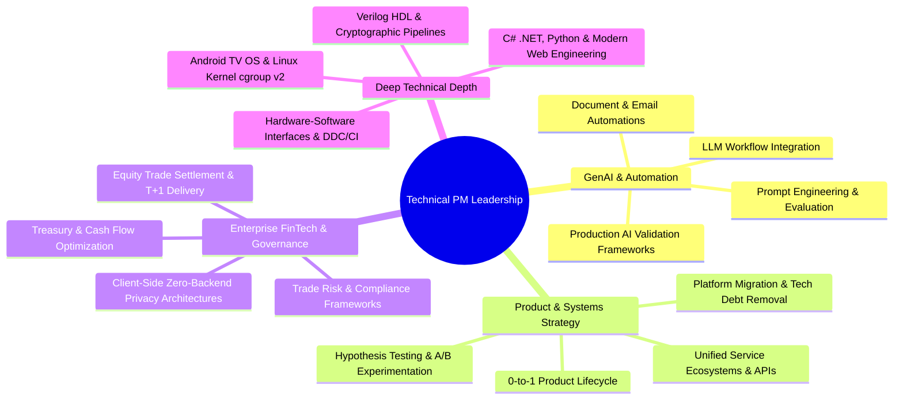

# Kshitij Garg 👋

### **Lead Technical Project & Product Manager | GenAI & High-Scale Systems**
*Transforming Complex Systems via AI-First Automation, Systems Performance & 0-to-1 Product Delivery*

---

## 🚀 Executive Summary

I am a **Technical Project & Product Leader** with over 6 years of experience driving large-scale automation initiatives, GenAI-integrated platform modernization, and cross-functional operational excellence. 

My career spans leading complex technical transformations across **Global Travel Tech (Agoda / Booking Holdings)** and **Tier-1 Global Financial Institutions (Citibank, NatWest)**:
- **GenAI & AI-First Operational Transformation:** Architected "0 to 1" journeys of enterprise GenAI workflows, automating mission-critical customer operations and email intelligence, delivering multi-million-dollar cost efficiencies and double-digit CSAT gains.
- **Deep Systems Modernization & Technical Debt Resolution:** Led core platform migrations, API unifications, and central CMS consolidations connecting siloed enterprise ecosystems to eliminate agent context-switching latency.
- **FinTech & Regulatory Engineering:** Designed and launched end-to-end compliance risk frameworks and robotic process automations for global trade finance, letter-of-credit systems, and accelerated equity trade settlement ($T+1$ stock delivery).
- **Engineering Pedigree:** Backed by a rigorous foundation in **Electronics & Communication Engineering from IIIT Allahabad** (Top 8th percentile) and an **MBA in Strategy & Product from IIM Kozhikode** (Top 7th percentile).

---

## 🏆 Featured Flagship Systems

| Platform | Category | Impact & Technical Highlights |
| :--- | :--- | :--- |
| **[Sony BRAVIA 4K Debloater & Launcher](https://github.com/kshitij-garg/sony-bravia-vh2-debloater)** | **Embedded Systems & Consumer OS** | Re-engineered Google TV for Sony 4K Smart TVs into an ultra-snappy, zero-telemetry Apple TV-style media hub. Custom 328 KB Leanback launcher, Linux kernel `cgroup v2` freezer, in-memory tactile acoustic synthesis, and 100% reversible recovery architecture. |
| **[QuantRebalance Portfolio Engine](https://github.com/kshitij-garg/quant-rebalance)** | **FinTech & Quantitative SaaS** | Institutional-grade multi-strategy equity & ETF portfolio rebalancing platform for Indian markets. 100% client-side privacy architecture (zero server storage), mathematical drift optimization, and tax-loss harvesting logic. 👉 **[Live Web Application](https://kshitij-garg.github.io/quant-rebalance/)** |
| **[Monitorian 2.0](https://github.com/kshitij-garg/Monitorian-2.0)** | **Desktop Systems & Global Utility** | Windows multi-monitor hardware brightness & contrast controller via DDC/CI I2C protocols. Features global user hotkeys, scheduled day/night transitions, single-file portable zero-install packaging, and 28 global language localizations. |
| **[Hardware UART & SHA-1 Crypto Core](https://github.com/kshitij-garg/UART-Verilog)** | **Digital Logic & Hardware Design** | Synthesizable Verilog HDL implementation of a full-duplex UART transceiver with a dedicated pipelined 80-round SHA-1 hardware cryptographic hashing accelerator. |

---

## 🧩 Core Competencies & Cross-Functional Toolkit

---

## 🎓 Academic & Professional Pedigree

### **Education**
- **Indian Institute of Management (IIM), Kozhikode** — *Master of Business Administration (MBA)*
  - **Academic Standing:** Ranked in the **Top 7th percentile** across 473 students.
  - Specialization in Product Strategy, Technology Operations, and Business Economics.
- **Indian Institute of Information Technology (IIIT), Allahabad** — *B.Tech in Electronics & Communication Engineering (ECE)*
  - **Academic Standing:** Ranked in the **Top 8th percentile** across 76 students (GPA: 9.12 / 10).
  - Focus on Digital System Design, Microprocessors, Cryptographic Hardware, and Data Structures.

### **Industry Track Record**
- **Project Manager, Lead — Agoda (Booking Holdings)** *(Jan 2023 – Present)*
  - Spearheading AI-first transformation strategy across customer operations; managing cross-functional initiatives delivering multi-million-dollar cost savings.
  - Led the delivery of a unified service ecosystem consolidating disparate contact platforms into a centralized CMS.
- **Analyst, Treasury & Trade Solutions — Citibank N.A** *(Jul 2021 – Dec 2022)*
  - Designed and executed end-to-end compliance risk frameworks across trade finance products; launched equity trade settlement automations for $T+1$ delivery.
- **Graduate Engineer — NatWest (Royal Bank of Scotland)** *(Jul 2018 – Jun 2019)*
  - Engineered high-throughput database ETL pipelines and automated business intelligence for general ledger reconciliation; honored with the *Living Our Values* award.

---

## ⏱️ Chronological Project Timeline

A complete timeline of open-source software, quantitative systems, and hardware engineering platforms developed over the years:

| Year | Project / Platform | Domain & Stack | Focus & Impact | Links |
| :---: | :--- | :--- | :--- | :---: |
| **2026** | **Sony BRAVIA 4K Debloater & Apple TV Launcher** | Android TV, Java, Linux Kernel, PowerShell | Replaces bloated stock Google TV interface with a custom native 328 KB Leanback launcher, Linux `cgroup v2` freezer, and zero-telemetry debloater toolkit. | [Repository](https://github.com/kshitij-garg/sony-bravia-vh2-debloater) |
| **2026** | **Monitorian 2.0** | Windows Desktop, C#, WPF, Win32, DDC/CI | Multi-monitor hardware display controller with global hotkeys, scheduled day/night mode, and single-file portable deployment across 28 languages. | [Repository](https://github.com/kshitij-garg/Monitorian-2.0) |
| **2026** | **QuantRebalance Web Engine** | FinTech, Vanilla JS, HTML5/CSS3, Yahoo Finance | Zero-backend institutional portfolio rebalancing tool for Indian equities and ETFs with zero capital-gains tax smart cash deployment. | [Repository](https://github.com/kshitij-garg/quant-rebalance) • [Live App](https://kshitij-garg.github.io/quant-rebalance/) |
| **2026** | **Stonks Algorithmic Core** | FinTech, Python, Statistical Backtesting | Companion quantitative engine featuring multi-asset risk parity modeling, drift tolerance bands, and automated portfolio rebalancing backtesters. | [Repository](https://github.com/kshitij-garg/stonks) |
| **2021** | **CoWIN Vaccine Availability Scheduler** | Automation, Python, REST APIs | Multi-threaded real-time vaccine slot monitoring and notification engine built during public health peak demand. | [Repository](https://github.com/kshitij-garg/cowin_alert) |
| **2018** | **Financial Ledger ETL & Reconciliation** | Enterprise FinTech, Oracle DB, SQL, BI | Automated data pipelines and financial reporting infrastructure for general ledger reconciliation at NatWest. | *Enterprise Platform* |
| **2017** | **Interactive Developer Web Platform** | Frontend, HTML5, CSS3, JavaScript | Lightweight web portfolio and interactive project landing page. | [Repository](https://github.com/kshitij-garg/garginator.github.io) |
| **2016** | **Full-Duplex UART & SHA-1 Cryptographic Accelerator** | Hardware Design, Verilog HDL, Modelsim | Synthesizable hardware digital design featuring full-duplex asynchronous serial transceiver coupled with an 80-round SHA-1 hardware hashing pipeline. | [Repository](https://github.com/kshitij-garg/UART-Verilog) |
| **2016** | **Algorithmic Solutions & Data Structures** | Computer Science, C++, Algorithms | Comprehensive algorithmic challenge solutions covering dynamic programming, graph theory, and advanced numerical computation. | [Repository](https://github.com/kshitij-garg/Code) |

---

## 📬 Connect & Collaborate

- 💼 **LinkedIn:** [linkedin.com/in/garg-kshitij](https://in.linkedin.com/in/garg-kshitij)
- 🌐 **GitHub:** [@kshitij-garg](https://github.com/kshitij-garg)
- 💻 **Live Product Demos:** [QuantRebalance Web App](https://kshitij-garg.github.io/quant-rebalance/)
