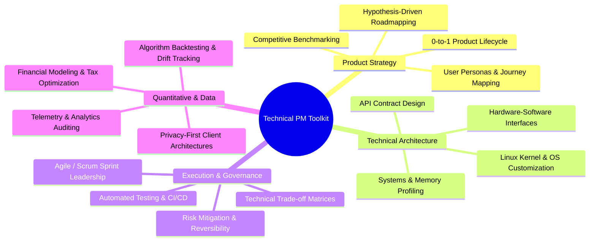

# Hi there, I'm Kshitij Garg 👋

### **Technical Product Manager / Technical Project Manager**
*Bridging Deep Systems Engineering, Quantitative FinTech, and 0-to-1 Product Delivery.*

---

## 🚀 About Me

I am a **Technical Product Manager (TPM / PM)** who thrives at the intersection of complex systems architecture, product discovery, and metrics-driven execution. 

With a background spanning **hardware synthesis, low-level OS/kernel optimization, quantitative algorithmic platforms, and desktop utility engineering**, I specialize in translating ambiguous, high-friction technical challenges into intuitive, high-impact user experiences.

- 🎯 **Product Philosophy:** Obsession with latency reduction, zero-friction user onboarding, privacy-by-design, and high-leverage automation.
- 🛠️ **Technical Depth:** Deep proficiency in Android/Linux system architecture, C#/.NET desktop internals, algorithmic financial engineering, hardware description languages (Verilog), and client-side web optimization.
- 📈 **Execution Focus:** 0-to-1 product strategy, technical trade-off matrices, cross-functional engineering alignment, and user-centric iterative roadmapping.

---

## 🏆 Featured Flagship Products

| Product | Focus Area | Impact & Architecture |
| :--- | :--- | :--- |
| **[Sony BRAVIA 4K Debloater & Launcher](https://github.com/kshitij-garg/sony-bravia-vh2-debloater)** | **Embedded Systems & Consumer UX** | Re-engineered Google TV for Sony BRAVIA 4K into an ultra-snappy, zero-telemetry Apple TV-style media hub. Custom 327 KB Leanback launcher, Linux kernel `cgroup v2` freezer, 100% reversible architecture, and in-memory acoustic sound engine. |
| **[QuantRebalance Portfolio Engine](https://github.com/kshitij-garg/quant-rebalance)** | **FinTech & Quantitative SaaS** | Standalone institutional-grade equity & ETF portfolio rebalancer for Indian markets. 100% client-side privacy architecture (zero backend), multi-strategy allocation modeling, and tax-loss harvesting logic.  👉 **[Live Web App](https://kshitij-garg.github.io/quant-rebalance/)** |
| **[Monitorian 2.0](https://github.com/kshitij-garg/Monitorian-2.0)** | **Desktop Systems & Global Product** | Windows multi-monitor brightness & contrast controller via DDC/CI hardware I2C protocols. Features global user hotkeys, scheduled day/night transitions, single-file portable deployment, and 28 global language localizations. |

---

## 🧩 Core Product & TPM Competencies

---

## 🛠️ Technical Stack & Tooling

- **Product & Project Leadership:** Product Requirements Documents (PRD), Technical Design Documents (TDD), User Stories, Agile/Scrum, Roadmap Prioritization, Risk & Dependency Management.
- **Languages & Frameworks:** Java (Android TV / Leanback), C# (.NET / WPF), Python, JavaScript / Modern Web (HTML5/CSS3), Verilog HDL, PowerShell.
- **Systems & Platforms:** Android 12 (Google TV / Leanback API 31), Linux Kernel Internals (`cgroup v2`, process scheduler), Windows APIs (DDC/CI, Win32, Shell), Google ADB.
- **FinTech & Quantitative:** Portfolio Rebalancing, Asset Drift Tracking, Core-Satellite Allocation, Risk Parity, Technical Analysis (RSI, SMA).
- **DevOps & Tooling:** Git, GitHub Actions (CI/CD), GitHub CLI, Android SDK / Gradle, Visual Studio, VS Code.

---

## 📬 Connect With Me

- 🌐 **GitHub:** [@kshitij-garg](https://github.com/kshitij-garg)
- 💼 **LinkedIn:** [Connect on LinkedIn](https://linkedin.com)
- 💻 **Live Product Demos:** [QuantRebalance Engine](https://kshitij-garg.github.io/quant-rebalance/)
